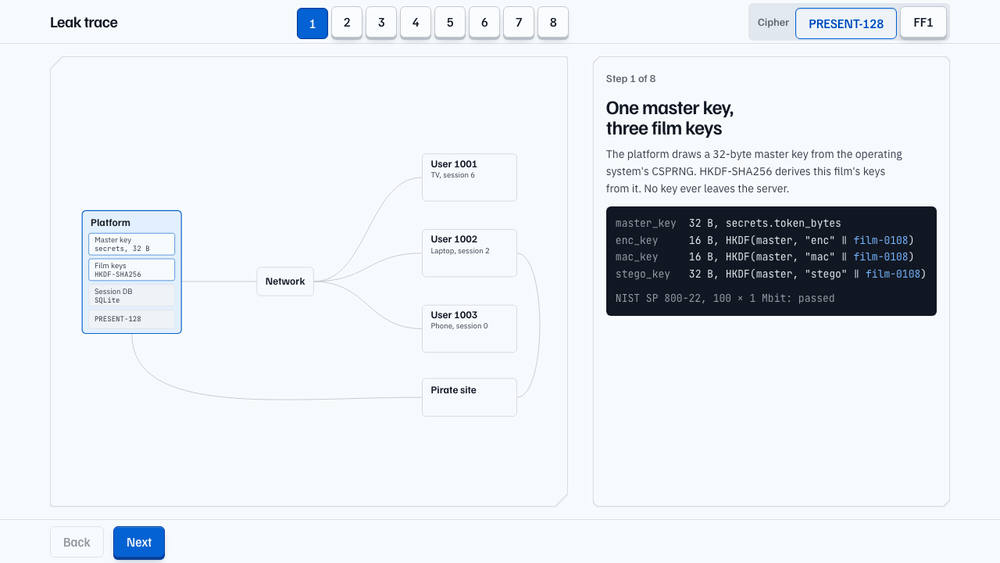
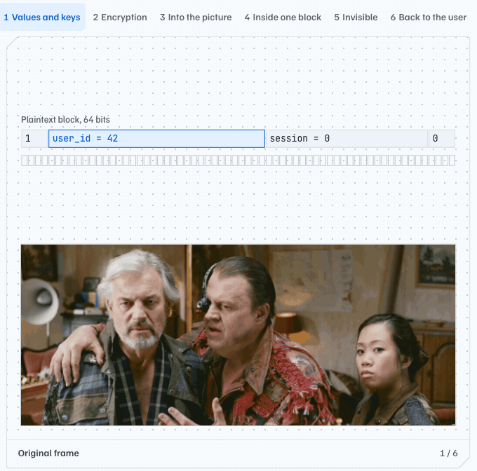
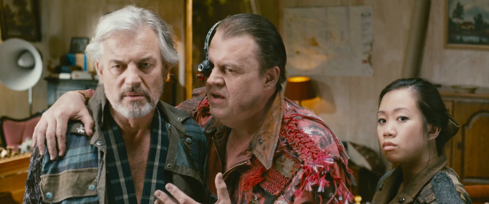
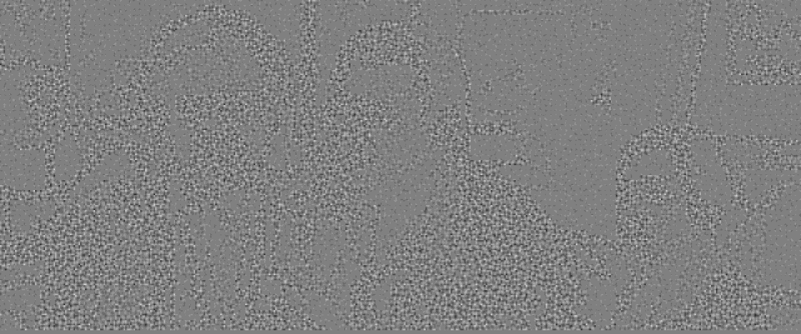
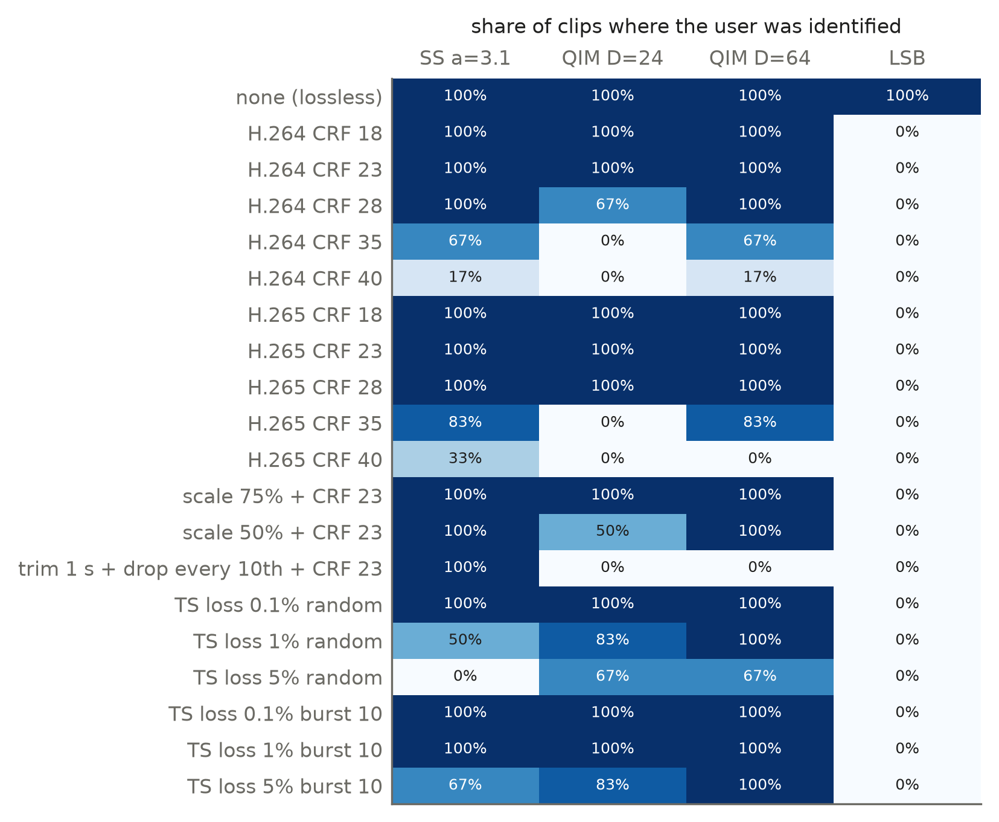
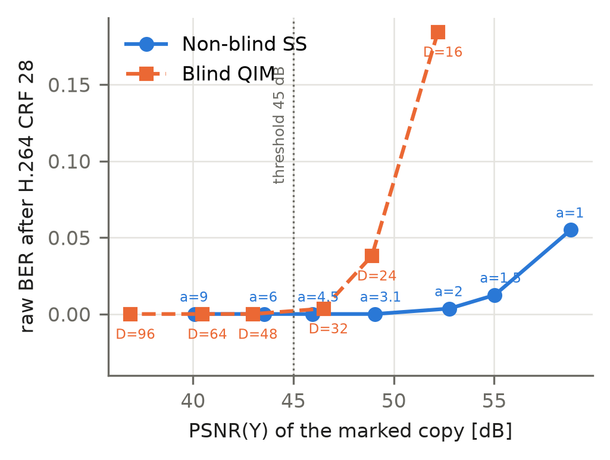
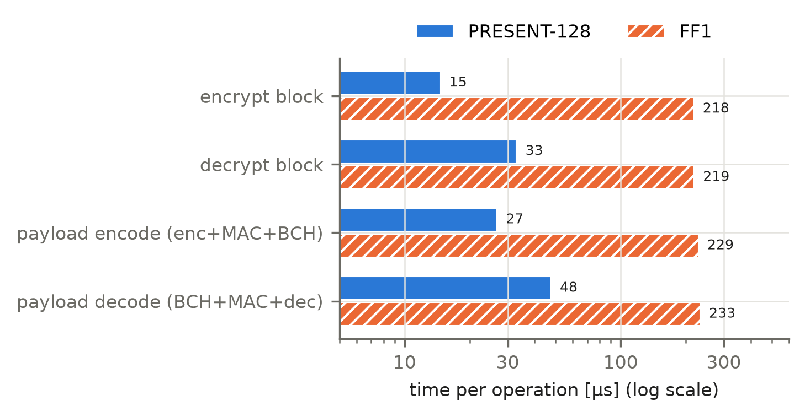
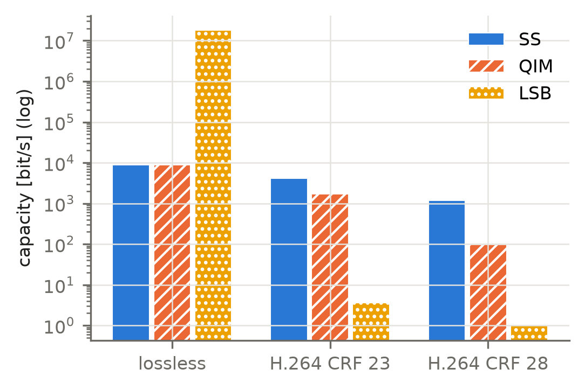
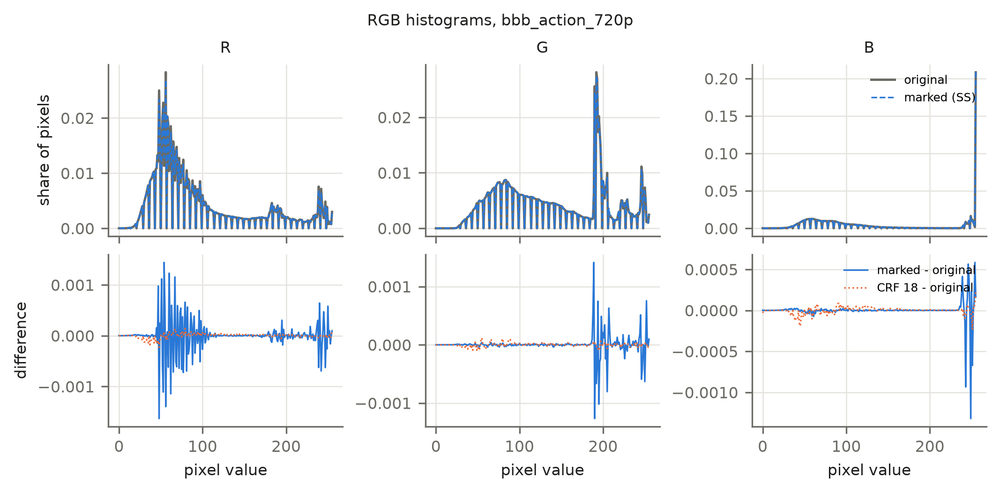

# Forensic video watermarking for a film streaming platform

Every viewing session gets its own copy of the film. The viewer's ID and session number are encrypted, authenticated and hidden invisibly in the picture. When a copy appears on a pirate site, the platform reads the mark back and identifies the viewer who leaked it. The mark survives re-encoding, downscaling, trimming and packet loss.



*The whole scenario on a real run. The platform marks three viewers' copies. User 1002 leaks a copy that was halved in size and re-encoded at CRF 33. The platform traces it back to user 1002, session 2. Live version: `presentation/network_sim/index.html` (←/→ to step, C to switch cipher).*

## How it works

| Part | Choice |
|---|---|
| Payload | 64-bit block `VER 4 \| user_id 32 \| session 24 \| reserved 4` |
| Ciphers | **PRESENT-128** (ISO/IEC 29192-2) and **FF1** (NIST SP 800-38G, film ID as tweak, AES-128 inside). Both keep the ciphertext at 64 bits. |
| Integrity | SipHash-2-4 truncated to 32 bits, encrypt-then-MAC with a key commitment. The tag is checked in constant time before decrypting. |
| Keys | Master key from the OS CSPRNG (`secrets`). Per-film keys come from HKDF-SHA256, and the embedding patterns from SHAKE-256. |
| Error correction | BCH(188,96), corrects 12 bit errors. 188 bits are embedded. |
| Hiding | Non-blind additive spread spectrum in the Y channel: low 8×8 DCT band (zigzag 1–5), texture masking, bits held for key-dependent groups of about 1 s, soft combining. |
| Extraction | Rescale the pirate copy, align it to the original frame by frame (dynamic programming), correlate, then BCH → MAC → decrypt. A wrong key, damage or a forgery all give the same `NoValidMark`. |
| Baselines | Blind QIM/STDM and LSB matching, used for comparison only. |

All cryptography is implemented in pure Python and checked against official known-answer tests: FIPS 197, SP 800-38A and SP 800-38G for AES and FF1, the SipHash reference vectors, and OpenTitan vectors for PRESENT-128. That keeps the speed comparison of the two ciphers fair. `cryptography` is used only for HKDF and as a cross-check in the tests.

### One ID, step by step



*The values in this walkthrough come from the project code:*

1. *The 64-bit block holding user 42 is built and the keys are derived.*
2. *The block is encrypted with PRESENT-128.*
3. *The tag and BCH are added and the 188 bits are spread over the frame's 8×8 blocks.*
4. *Inside one block, the ±1 pattern changes five DCT coefficients.*
5. *The marked frame is shown next to its ×20 difference.*
6. *The leaked copy is aligned and correlated, then BCH, MAC and decryption give back the viewer.*

*Live version with the FF1 switch: `presentation/watermark_animation/index.html`.*

## Results

The mark is invisible. The frames below show the original, the copy marked for one viewer, and their difference amplified 20 times. PSNR(Y) is 49.1 dB.

| Original | Marked | Difference × 20 |
|---|---|---|
|  |  |  |

Every test was run on 6 clips: two CIF test sequences, park_joy 720p50, and an action scene, a dark scene and a static scene from three Blender films. Test (a) also used every clip as MP4, MKV and AVI. Tests (a) and (d) also include a 1080p clip.

| Test | Result |
|---|---|
| (a) Accuracy | 42 / 42 marked copies traced to the right viewer with 0 bit errors (7 clips × MP4, MKV, AVI × PRESENT-128, FF1). Large data (1 KB, 64 KB, 1 MB, LSB): 36 / 36 recovered bit for bit. |
| (b) Degradation | Viewer found in 6 / 6 clips after H.264 or H.265 up to CRF 28, 50 % downscale, trimming with frame drops, and 1 % burst packet loss. At CRF 35: 4 / 6 (H.265: 5 / 6). |
| (c) Wrong key | 0 of 96 wrong-key, wrong-film, unmarked, replayed or forged copies returned an ID. 0 of 100,000 random codewords were accepted. |
| (d) Performance | PRESENT-128: 14.6 µs per block, 0.48 MB/s. FF1: 218 µs, 0.035 MB/s (pure Python). Embedding takes 15–46 s per minute of 720p video, with at most 181 MB of RAM. |
| (e) Quality | PSNR(Y) 49.0–49.1 dB, SSIM(Y) 0.993–0.999, VMAF 96.3–99.9. The thresholds of 45 dB and 0.99 were set before the tests. |
| (f) Capacity | 1.6–14.4 kbit/s raw, 0.5–7.7 kbit/s usable after CRF 23. LSB carries megabits, but nothing survives re-encoding. |
| (g) Steganalysis | The RGB histograms change by the same order as an ordinary CRF 18 re-encode: χ² ≤ 0.0014 against ≤ 0.0016. A DCT calibration detector scores AUC 0.58 on a CRF 23 copy, close to chance. |

**Robustness (test b):** the share of clips in which the viewer was identified, per attack and method. "SS" is our method. QIM is a blind baseline at the same quality (Δ=24) and at lower quality (Δ=64). LSB is a fragile baseline.



**Quality and robustness (test e):** bit error rate after H.264 CRF 28 against image quality. At the 49 dB we use, spread spectrum has no errors. Blind QIM needs Δ ≥ 32 to match it, which pushes SSIM below 0.99.



**Cipher speed (test d):**



**Capacity (test f):** bits per second the mark can carry, on a log scale. LSB holds megabits only when the copy is lossless. After re-encoding, only the DCT methods keep a usable channel.



**Colour histograms (test g):** RGB histograms of the original and the marked copy on the action clip, and the change caused by the mark next to the change caused by a plain CRF 18 re-encode.



Tests (a) and (c) are pass/fail counts, so they appear only in the table above.

Limitations: small CIF clips lose the ID at CRF 35, where there is less picture to carry the mark. With random packet loss (1 % and above), the blind QIM baseline does better than our method. This is probably because QIM reads every frame on its own, while our method has to align the damaged frames to the original. Filming the screen and geometric attacks are outside the threat model.

More figures: [BER vs CRF](results/fig_b_ber_vs_crf.png). All raw numbers are in `results/*.csv`.

## Setup

Requires Python ≥ 3.11 and FFmpeg (with `libvmaf` for the VMAF metric).

```bash
python3 -m venv .venv
./.venv/bin/pip install -r requirements.txt
./.venv/bin/python -m pytest -q
```

## Usage: mark your own video and trace a leak

The command line plays the platform. It has four steps. Run every command from the repository root:

```bash
export PYTHONPATH=src
PY=./.venv/bin/python
```

**1. Create the platform's master key.** You do this once. Every film key is derived from it.

```bash
$PY -m videowm keygen --key platform.key
```

The key file is created with mode 0600. Without this file no copy can be traced, so do not lose it and never commit it.

**2. Register your video and choose the cipher.** The cipher is fixed per film: `--alg present` uses PRESENT-128 (the default) and `--alg ff1` uses FF1.

```bash
$PY -m videowm register-film --db platform.sqlite --film-id MYFILM-P --original /full/path/to/my_video.mp4 --alg present
$PY -m videowm register-film --db platform.sqlite --film-id MYFILM-F --original /full/path/to/my_video.mp4 --alg ff1
```

- Any format FFmpeg can read works as input (MP4, MKV, AVI, MOV, …).
- To compare the two ciphers on the same video, register it twice under two film IDs, as above.
- Give the full path. The database stores the path, and tracing reads the unmarked original from it, so leave the file where it is.
- `--alpha` sets the mark strength. The default, 3.1, keeps PSNR(Y) ≥ 45 dB and SSIM ≥ 0.99. A higher value is more robust but more visible.

**3. Make a marked copy for a viewer.** Each call opens a new session for that user, so two copies for the same user are still told apart.

```bash
$PY -m videowm embed --db platform.sqlite --key platform.key --film-id MYFILM-P --user-id 1001 --out copy_1001.mkv
# copy for user 1001 (session 0) written to copy_1001.mkv: 300 frames, PSNR(Y) 49.1 dB, 0.7 s
```

- The output container follows the extension: `.mkv` and `.avi` are FFV1 and `.mp4` is H.264 with `-qp 0`. All three are lossless, so the files are large.
- A real platform would compress the copy before streaming, e.g. `ffmpeg -i copy_1001.mkv -c:v libx264 -crf 23 stream_1001.mp4`. The mark survives this.
- Only the video track is written. To put the original audio back: `ffmpeg -i copy_1001.mkv -i my_video.mp4 -map 0:v -map 1:a? -c copy copy_1001_audio.mkv`.
- `user-id` is a 32-bit number. The session number is assigned automatically.
- Speed: a 720p video takes about 15–46 s per minute of video, 1080p about 106 s.

**4. Trace a leaked copy.** Give the film ID of the leaked film and the suspicious file:

```bash
ffmpeg -i copy_1001.mkv -vf scale=iw/2:ih/2 -c:v libx264 -crf 23 leak.mp4   # simulate a pirate: half size, re-encoded
$PY -m videowm trace --db platform.sqlite --key platform.key --film-id MYFILM-P --pirate leak.mp4
# watermark valid: user 1001, session 0 (1 bit errors corrected, 300 frames, 1.1 s)
# issued 2026-11-20T05:56:55+00:00 as copy_1001.mkv
```

- Exit codes: `0` means the viewer was found. `2` means no valid mark was found: unmarked video, wrong key or wrong film ID, or too much damage. `3` means the MAC was valid but no issued copy in the database matches it.
- The pirate copy may be re-encoded (H.264/H.265), downscaled, trimmed, have frames dropped or have lost packets. The tracer rescales it and aligns it to the original by itself.

**Without the command line:** Mark studio is a local web page that runs the same pipeline. You can upload a video, choose PRESENT-128 or FF1, enter a viewer ID, mark the first 5–60 s, and compare the original, the marked copy and the ×20 difference:

```bash
PYTHONPATH=src ./.venv/bin/python scripts/mark_studio.py   # then open http://127.0.0.1:8765
```

## Test data

Videos are not in the repository. Download them into `data/raw/`:

```bash
mkdir -p data/raw/bbb720 data/raw/sintel720 data/raw/tos720 && cd data/raw
curl -o foreman_cif.y4m https://media.xiph.org/video/derf/y4m/foreman_cif.y4m
curl -o akiyo_cif.y4m   https://media.xiph.org/video/derf/y4m/akiyo_cif.y4m
sh ../download.sh            # Big Buck Bunny, Sintel, Tears of Steel (720p), park_joy 720p50, crowd_run 1080p50
cd ../..
PYTHONPATH=src ./.venv/bin/python scripts/prepare_dataset.py   # cuts the 10 s test clips into data/clips/
```

`data/resume_xiph.sh` resumes the large Xiph downloads if they stall.

### Sources and credits

No video file is redistributed in this repository. The only material taken from the videos is a few still frames in `presentation/`, listed below.

| Clip | Source | Licence / terms |
|---|---|---|
| Big Buck Bunny | © 2008 Blender Foundation, [peach.blender.org](https://peach.blender.org) | [CC BY 3.0](https://creativecommons.org/licenses/by/3.0/). The frames in `presentation/network_sim/` and `docs/network_trace.gif` are taken from it and modified (watermark added). |
| Sintel | © Blender Foundation, [durian.blender.org](https://durian.blender.org) | [CC BY 3.0](https://creativecommons.org/licenses/by/3.0/) |
| Tears of Steel | (CC) Blender Foundation, [mango.blender.org](https://mango.blender.org) | [CC BY 3.0](https://creativecommons.org/licenses/by/3.0/). The frames in `presentation/watermark_animation/`, `docs/watermark_walkthrough.gif` and the Results section are taken from it and modified (watermark added). |
| akiyo, foreman (CIF) | Standard video test sequences, distributed by [Xiph.org Video Test Media](https://media.xiph.org/video/derf/) | Used for research and testing only, under the terms stated there |
| park_joy, crowd_run | SVT (Sveriges Television) test sequences, distributed by [Xiph.org Video Test Media](https://media.xiph.org/video/derf/) | Used for research and testing only, under the terms stated there |

## Evaluation

The scripts in `evaluation/` implement the test scenarios of the assignment:

| Script | Scenario |
|---|---|
| `a_accuracy.py` | (a) accuracy, small and large data, MP4 / MKV / AVI |
| `b_degradation.py` | (b) H.264/H.265 re-encoding, scaling, trimming and frame drops, MPEG-TS packet loss |
| `c_wrong_key.py` | (c) wrong key, wrong film, unmarked and forged copies |
| `d_performance.py` | (d) speed, CPU and memory of PRESENT-128 vs FF1, embedding and extraction cost |
| `e_quality.py` | (e) PSNR, SSIM, VMAF, BER, encryption and embedding times |
| `f_capacity.py` | (f) raw and usable capacity |
| `g_histogram.py` | (g) colour histograms and steganalysis |

`sh evaluation/run_all.sh` runs all of them, which takes hours. Logs go to `data/out/logs/`; CSV files and figures go to `results/`, where the measured results are already included.

For a quick run on one clip:

```bash
VIDEOWM_CLIPS=akiyo_cif VIDEOWM_RESULTS=data/out/smoke_results PYTHONPATH=src ./.venv/bin/python evaluation/e_quality.py
```

## Repository layout

| Path | Content |
|---|---|
| `src/videowm/` | The package: `ciphers/` (AES, FF1, PRESENT, SipHash), `keys.py`, `payload.py`, `video_io.py`, `dct.py`, `embed/` (spread spectrum, QIM, LSB), `align.py`, `extract.py`, `db.py`, `cli.py`, `attacks.py`, `metrics.py`, `bulk.py` |
| `tests/` | pytest unit tests, including the cipher KATs |
| `evaluation/` | Test scenarios (a)–(g) and plots |
| `results/` | Measured results (CSV) and figures |
| `scripts/` | Dataset preparation, comparison videos, data for the demo pages, viewing-test clips |
| `docs/` | README animations (`scripts/make_readme_gifs.sh` rebuilds them from the demo pages with headless Chrome) |
| `presentation/` | HTML demo pages: watermark walkthrough, network simulation, Mark studio |
| `subjective_test/` | 2AFC viewing-test page (generate the clips with `scripts/make_2afc_clips.py`) |
| `experiments/` | Prototype scripts behind the design decisions (separate `requirements.txt`) |

### Demo pages

- `presentation/watermark_animation/index.html` and `presentation/network_sim/index.html` open directly in a browser. To regenerate their data, run `scripts/make_animation_data.py` (followed by `presentation/watermark_animation/build.py`) and `scripts/make_network_sim_data.py`.
- Mark studio runs the real pipeline from a local web page. Start it with `PYTHONPATH=src ./.venv/bin/python scripts/mark_studio.py`, then open http://127.0.0.1:8765.
